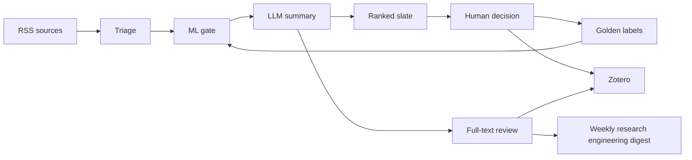
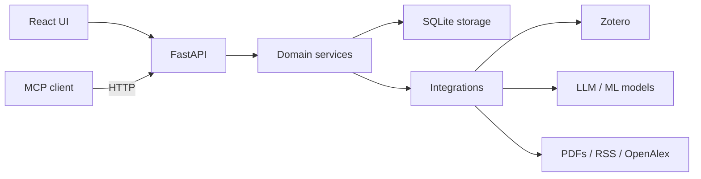
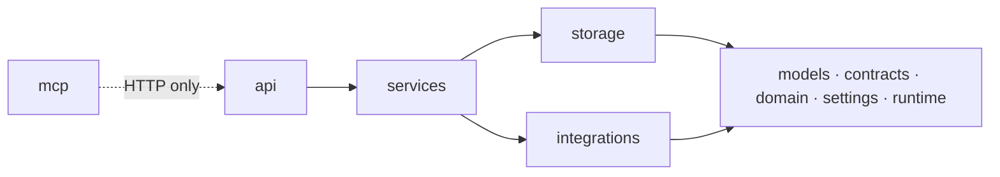

# Architecture

The whole app in one mental model, plus the rules the pre-commit hooks enforce.
Read this before editing; every package also has its own `README.md`.

## Product loop — what does the system do?

Read this first when onboarding or changing triage, ranking, review, or feedback
semantics. It is for users, researchers, product owners, and new contributors.



1. **triage** fetches RSS itself into an app-owned pool and scores it (gate
   first, LLM for survivors) into SQLite.
2. **model** is the relevance gate — trained on your labels, it ranks everything.
3. **api** serves the React UI and the JSON API; routes are thin.
4. **you** cull on *Today*, read on *Library*, fine-label on *Annotate*.
5. **golden** is your label dataset; **model** retrains on it — the loop closes.
6. **zotero** writes reviewed papers into the *Inbox* only after an explicit
   Add/positive verdict, approved label tags/notes (queued + reviewed, backup
   first), and read-state sync for Zotero feed cards triaged by the app.

## Runtime view — which subsystem owns this?

Read this when implementing a feature, adding an integration, or debugging a
cross-boundary workflow. It is the main view for developers and reviewers.



## Code layering — what may import what?

Read this before creating or moving modules, or while reviewing architecture
changes. It mirrors the rules enforced by `check_import_policy.py`.



Start with the product loop, then drill into the runtime and layering views only
as needed. Add a focused data-ownership, sequence, deployment, or component view
only when multiple writers, non-obvious orchestration, multiple processes, or an
oversized domain makes that deeper view necessary.

## Why it's built this way (decisions + evidence)

The loop above is the *what*; the *why* — every technical choice with its measured number and the
rejected alternatives (with the numbers that killed them) — lives in three companion docs kept
locally under `docs/internal/` (untracked rationale notes, not part of the shared repo):

```
 docs/internal/decisions.md          ADRs: decision → evidence → reproduce command → rejected alt
 docs/internal/validated_defaults.md Tier-0 provenance ledger for each shipped knob default
 docs/internal/knowledge_map.md      parameters × models × status (M measured / P provisional / G guess)
```

Status legend (used across all three): **✅ MEASURED** (real data + reproduce), **⚠️ PROVISIONAL**
(operational baseline; harness built, head-to-head deferred — the open measurement is in
`decisions.md` §GAP), **❓ GUESS** (labelled in code), **❌ REJECTED** (measured-worse; do not
re-propose without new evidence). **Before re-proposing a ❌ or flipping a ⚠️ default, rerun the
cited eval on the same real data and beat the recorded number.** No new evidence → no re-litigation.

## Triage trigger: daemon vs UI

Triage (the pipeline above) runs identically whether it is triggered by:

- the **UI** — the *Today* tab's "Triage backlog" button (`POST /api/daily/triage-backlog`),
  on demand; or
- the **daemon** — `zotero-summarizer feeds serve`, a separate long-running process
  that ticks on a timer, scores feeds and optionally reviews the Today slate in place,
  but never adds a pick to Zotero without an explicit user Add after review; or
- the **CLI** — `feeds run` / `feeds tick` one-shots.

The daemon is optional automation, not a separate engine. The `feeds.*` block in
`goals.yaml` only applies when the daemon runs.

## Where things live

| You want to… | Go to |
|---|---|
| add/change an HTTP endpoint | `api/routes/` (logic → `services/`) |
| change scoring / the ML gate | `services/model/` |
| change labels / training data | `services/golden/` |
| change the feed daemon / Today slate | `services/triage/` |
| change reading / review surfaces | `services/library/` |
| change the weekly project-specific research digest | `services/research_feed/` |
| change what gets written to Zotero | `services/zotero/` |
| touch the DB / SQL | `storage/` |
| talk to Zotero / PDFs / LLM / OpenAlex | `integrations/` |
| change the agent (MCP) surface | `mcp/` (HTTP client only) |
| wire process-wide singletons at startup | `services/lifecycle.py` → `runtime.RuntimeState` |

The live JSON API is self-documenting: run `serve` and open `/docs` (OpenAPI).

Deep-review source ownership stays explicit: map-reduce notes feed generation,
while the original paper feeds verification, including correction and fallback.
Rank/prefix verification uses its selected original spans. Empty sources or map
summaries fail before review publication, not as scientific-quality judgments.
See `services/library/README.md` for the contract and remaining context-limit caveat.

## Layering rules (lower never imports higher)

- `integrations/`, `storage/` never import `services/` or `api/`.
- `mcp/` never imports `services/`, `api/`, or `storage/`.
- `services/` may import `api.errors` only (never `api.app` / `api.routes`).

## Data & config

- All app state lives under `data/` (gitignored): the two SQLite DBs
  (`triage_history.db`, `corpus_cache.db`), your golden dataset, logs, the
  append-only **agentic interaction log** (`interaction-events.jsonl` — the
  immutable human-decision + model-prediction trajectory for offline improvement;
  see `services/interaction_log.py`), and ML artifacts. Every path comes from
  `Settings` — never hardcode `project_root / "..."`.
- Config: `.env` (secrets/paths) + `goals.yaml` (**intent only** — research goals,
  triage criteria, rubric, language + the LLM connection; the `USER_OWNED_KEYS`
  allowlist in `models/config.py`). Technical knobs (corpus, prestige,
  quality_review, classifier_gate, prompts) are validated code defaults, overridable
  via `ZS_*` env (`services/config_overrides.py`, `docs/overrides.md`) and refined
  per-user by calibration (planned). Both files are gitignored; copy the `*.example`
  templates to bootstrap. See the README.
- Schema changes are version-gated migrations (`storage/migrations.py`): add a new
  numbered `Migration` step, never an inline `ALTER`.

## Guardrails (enforced by local checks)

Run `make lint` explicitly before committing; this does not auto-stash your tree.
The optional manual GitHub Actions workflow runs the canonical local checks too.
Commit hooks are not required by the PR workflow.

1. **≤500 LOC per `.py`, no exceptions** (`tools/precommit/check_file_loc.py`).
   There is no grandfather list; split by responsibility.
2. **Layering / structure policy** (`check_import_policy.py`) — the rules above; new
   service modules must live in a domain subpackage, not at `services/` top level.
   AST checks include relative, aliased, multi-name and nested static imports;
   this gate does not analyze dynamic imports or indirect runtime effects.
3. **Module READMEs** (`check_module_readme.py`) — every package has one, and editing
   a package's code requires staging its `README.md` in the same commit.
4. **Redundancy** (`check_redundancy.py`) — new *provably* redundant transforms
   (idempotent `f(f(x))`, faithful round-trips, identity comprehensions, involutions)
   BLOCK; conditionally-redundant transforms and near-duplicate functions are advisory.
   Existing findings frozen in `redundancy_allowlist.txt`.
5. **AI-slop** (`check_slop.py`) — adopts [aislop](https://github.com/scanaislop/aislop)'s
   deterministic slop/dead-code detectors (swallowed exceptions, debug leftovers, mutable
   defaults, untracked TODOs, narrative/trivial comments, generic names, Long-Method
   complexity). Debug leftovers BLOCK, as do touched functions above 88 body lines,
   6 required parameters, or 5 control-flow levels; other heuristics stay advisory.
   Existing findings are frozen in `slop_allowlist.txt`.

**Seeing findings (advisory, not enforced):** two commands, differing only in scope —
`make scan` (every detector across the whole tree) and `make scan-diff` (the same, scoped to
the `.py` changed vs the base branch). Both always exit 0 and never block; `EMBED=1` adds the
semantic code-model overlap pass, `BASE=<branch>` retargets the diff. The all-pairs **function-
overlap audit** (`tools/precommit/check_overlaps.py`) runs inside them — every function against
every function, ranked by a hybrid of a local code-embedding cosine + graded structural
similarity + API-Jaccard — surfacing consolidation candidates whose intent overlaps even across
different shapes; it degrades to deterministic-only when no embedding model is available.

## Verify a change

Backend tests isolate runtime state and the default project root per test, hide
inherited provider credentials/keyring entries, and block TCP connections. Mock
integrations explicitly; a unit test must never use a live model or Zotero service.
Before collection/fork, `tests/conftest.py` sets `no_proxy=*` for the test session.
This avoids macOS SystemConfiguration proxy discovery from HTTP client constructors
in forked children, as [documented by Python](https://docs.python.org/3.13/library/urllib.request.html).
It does not change application proxy configuration or fix native ML-library crashes.
The same session-owned `TemporaryDirectory` is also `PYTEST_DEBUG_TEMPROOT`:
forked tests never scan the global `pytest-of-*` backlog, parallel runs get separate
roots, and the parent removes its own temporary tree at session cleanup. Existing
global temporary files are untouched; an explicit `--basetemp` still takes precedence.

```text
commit → create-pr.sh → make check → push checked commit to origin → gh pr create
                            └─ any failure stops publication
```

Install development dependencies once (`uv sync --extra dev`, `npm ci --prefix frontend`),
then activate the intended environment (`source .venv/bin/activate`). In a worktree,
use that checkout's source with the shared interpreter on PATH; no environment is copied.
Pre-commit may provision its pinned Vulture hook environment on first use.

```bash
make lint                                         # before commit; sees staged README changes
make check                                        # checks only; also works with make -j
# Commit the intended files, then publish from a clean dedicated branch:
tools/create-pr.sh 'Short PR title' /path/to/body.md
```

`make check` runs existing owners serially: `make lint` (all nine pre-commit hooks),
`KMP_DUPLICATE_LIB_OK=TRUE make test` (`pytest -q --forked`), frontend `npm run lint`,
`npm test`, `npm run build` (disposable output), then `smoke-test --project-root .`
(app construction only, no server). Python smoke imports are pinned to this worktree.
Missing tools, failed checks and native crashes are failures, never exclusions or green
baseline exceptions. Build output is temporary: an existing `frontend/dist` is untouched.
Tests still create their normal isolated temporary files/caches. No model download or
service is requested by the check command.

The publisher accepts exactly a title and readable body file. It requires clean tracked,
staged and untracked source, refuses main/detached HEAD, and checks branch/commit identity
again after validation. It pushes only that checked commit, non-force, to the current
branch on `origin`, then creates a PR against `main` in that repository. It never stages,
stashes, resets, installs hooks or reverts checker edits. A checker that changes source
blocks publication and leaves the edit for you to inspect. A failed push blocks PR creation;
a failed PR request leaves the checked branch pushed and returns the CLI error.
Use an exclusively owned worktree: these identity checks are not a lock against concurrent
writers or remote branch changes. The README-freshness hook examines the index, so run lint
while package edits and their READMEs are staged; a clean post-commit run checks presence,
not historical freshness. The publication gate does not replace that commit-time policy.

GitHub Actions is manual-only (`workflow_dispatch`) and runs `make check` on Linux after
setup. Normal PR creation does not wait for hosted checks or billing/credits. This is a
trusted-repository convenience, not a sandbox, remote attestation or prevention of direct
`gh` bypass; existing external merge/status policies are unchanged.

macOS has historically hit LightGBM/torch native fork crashes; `--forked` isolates them.
If reproduced, retain the exact failing output and compare a clean baseline rather than
assuming it is a regression. A nonzero run still blocks this publisher. Use an environment
where the complete gate passes; do not silence failures or filter guessed test names.
