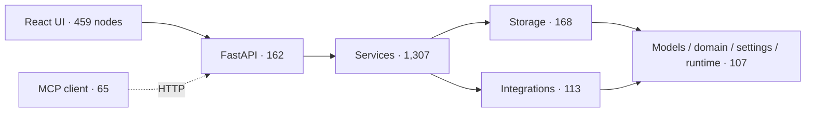
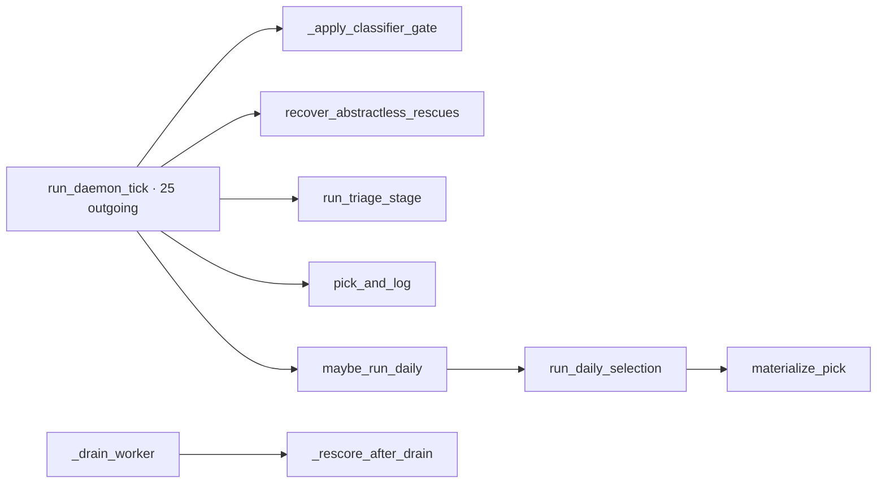

# Superseded RepoDoc report histories

These are the two complete reports present at the source1065 seed. They are
retained as history, not evidence of execution or issue acceptance. Their conflicting
numbers, provider statements and update outcomes are superseded by REPORT.md's
primary-artifact reconciliation. No raw timing/provider/update receipt accompanied
either document at the named retained locations.

## Original README.md

Seed SHA-256: `33019f69572e326b3e5ae3f3e00601c5f37fb7dad638afa790f8057aaaebe49c`

````markdown
# RepoDoc architecture-diagnostics experiment

**Decision: reject RepoDoc 0.1.0 at upstream commit
`306becd0f143211c0dde2bdbd480578356280e28`.** It can inventory a source-only
snapshot, but its graph, clustering, and incremental impact are too noisy to be
an architecture oracle. Keep it out of dependencies and CI. Re-evaluate when it
honors ignore files, resolves symbols by scope, fails closed on LLM errors, and
bounds incremental fan-out.

The 2026-08-27 experiment used the dirty worktree. Runtime artifacts remain in
gitignored `data/issue_runs/23/`; no generated docs or third-party code are
committed.

Any rerun requires an explicitly user-configured chat-compatible provider and
model; there is no default hosted backend. Keep credentials out of reports.

## CAPA and evidence

| Finding | Evidence | Disposition |
|---|---|---|
| Full scan exhausted resources | Stopped at 187.91 s and 1.49 GB RSS. RepoDoc selected 6,465 frontend files plus 2,238 agent-config files because it ignores neither `.gitignore` nor `node_modules`. | Keep outside the repo; require ignore-file support. |
| Source-only parsing works | Completed in 2.95 s / 94 MB with 2,585 components, 4,539 edges, and 246 leaves. | Useful only as an experiment input. |
| Call graph is unsound | A nested frontend `get` helper received 600 callers; it also invented Python/frontend and reverse-layer edges while the import-policy check passed. | Require scoped symbol resolution and zero false layer edges. |
| LLM errors report false success | Deliberate 401s produced arbitrary `batch_N` groups while the CLI printed `Clustering done`. | Require a nonzero exit and no fallback graph. |
| Successful clustering is unreadable | The explicitly user-configured model produced 41 flat, duplicated groups with no children. The run used at least 10,001 observable tokens. | Require 8–15 coherent groups and a hierarchy. |
| Incremental impact explodes | One class-docstring edit expanded to 366 affected components and 13 regenerations, then stalled for five minutes without a receipt. | Require bounded impact matching the changed component. |

Owner for containment/corrective action: repository maintainer. Upstream owns
parser and clustering defects; a future evaluator owns the preventive rerun.

## Go / no-go gates

| Gate | Result |
|---|---|
| Understandable in about 30 seconds | **Fail** — 41 flat groups. |
| Low enough density to expose smells | **Fail** — 4,539 noisy edges. |
| Correct against code/import policy | **Fail** — false cross-language and reverse-layer edges. |
| Answers a useful non-obvious question | **Fail** — reported hubs/cycles do not survive independent checks. |
| Incremental update follows impact | **Fail** — one edit expanded to 366 components and stalled. |
| Deterministic GitHub rendering | **Partial** — Mermaid renders, but useful grouping needs path-specific glue. |

The apparent 211 isolates, two multi-node cycles, and high-fan-in hubs all fail
cross-checks against Vulture and the executable import-policy gate. The existing
curated Mermaid views plus import, LOC, overlap, and dead-code checks are smaller,
deterministic, and more trustworthy.
````

## Original REPORT.md

Seed SHA-256: `60a13feaf1fd71a83cbff580a6e3c11497c31bc427aa72d0520ec50e421765ef`

````markdown
# RepoDoc experiment

**Date / revision:** 2026-09-24, `8f59dea` (`codex/sync-quality-issues`).
**RepoDoc:** `SYSUSELab/RepoDoc` shallow clone at `/tmp/zs-repodoc`; v0.1.0.
**Decision:** **Reject** RepoDoc as the living architecture layer for this repository.

## Run and cost

RepoDoc was installed in an isolated `/tmp` environment; no project dependency or
CI change was made. Its full-repository `analyze` ran for 2m17s, consumed about
900 MiB peak memory, and produced no artifact. A code-only copy containing
`zotero_summarizer/` and `frontend/src/` completed `analyze` in 1.7s:
2,458 components and 4,620 dependency edges. No LLM tokens were consumed by
analysis. `cluster` took 4.3s and made LLM requests with RepoDoc's invalid
default key; all retries returned HTTP 401. Token usage was therefore zero, and
RepoDoc fell back to two arbitrary batches (`batch_1`, `batch_2`), not semantic
modules. RepoDoc accepts an OpenAI-compatible `LLM_BASE_URL`, so I also tried
the running local Ollama endpoint with installed `qwen3.5:4b` and `qwen3:8b`.
Both reject chat completions with HTTP 400 (“does not support chat”); their
Ollama capabilities are completion-only. No model call succeeded and no tokens
were consumed. Generated files stayed under `/tmp`.

## System view

The node counts below are grouped from RepoDoc's code-only dependency graph by
directory. Relationships follow the repository's documented architecture
contract, since RepoDoc's inferred edges failed the correctness check below.



The counts show useful size, but this view is not generated architecture
documentation. The existing curated view in `docs/architecture.md` is clearer
and more accurate.

## Triage drill-down

The analyzed subgraph contained 192 components and 244 edges, split into 12 weak
components with 8 isolated nodes. RepoDoc identified `run_daemon_tick` as a hub
(25 outgoing edges), `make_candidate` as another high fan-out node (17), and
one cycle. The central orchestration neighborhood is:



This is only a rough code neighborhood; RepoDoc's cross-boundary links include
impossible edges (for example, `services → frontend` and `storage → services`).
Its graph therefore cannot be trusted to distinguish real layering violations
from name-resolution errors.

## Smells and incremental update

- **Cycles:** 63 in the whole code-only graph and one in the triage subgraph.
  These are candidates only; the tool does not validate whether its edges are
  correct.
- **Hubs:** `LibraryReadNext` (26 outgoing), `run_daemon_tick` (26), and
  `train_and_save` (23) were the top whole-graph nodes. The detected frontend
  links from backend/storage make these rankings unreliable.
- **Isolation:** eight isolated triage nodes are candidates, not proof of dead
  code. The graph also misses some expected calls, so Vulture/source review is
  needed before classifying them.
- **Layering:** observed reverse/invalid edges include storage→services,
  services→API, and services→frontend. These contradict the actual import
  policy and indicate graph extraction errors, not verified architecture bugs.
- **Incremental update:** not validated end to end. RepoDoc's `update` requires
  an initial knowledge graph/module tree produced by its generation pipeline;
  `analyze` and `cluster` alone do not produce the knowledge graph, and the
  generator/update path requires a chat-completions model. The default key
  returned 401, and the installed local Ollama models cannot serve chat
  completions. No claim of successful incremental artifact updates is made.
  A direct probe, `repodoc update . -o /tmp/zs-repodoc-output --base-commit
  HEAD --no-analyze-changes -y`, stopped immediately with “Knowledge graph not
  found”; no affected-module refresh could be observed.

RepoDoc did not surface a trustworthy non-obvious smell, did not form meaningful
modules with the default configuration, and could not demonstrate incremental
refresh. Retain the hand-curated Mermaid architecture views and existing
import-policy gate. Revisit only if RepoDoc can run with a chat-compatible model
and its emitted edges first pass the import-policy sanity check.
````

The nested Mermaid fences above are part of the original Markdown; these histories
are intentionally not rendered as experiment diagrams. No public report should
use these historical provider claims as current capability evidence.
